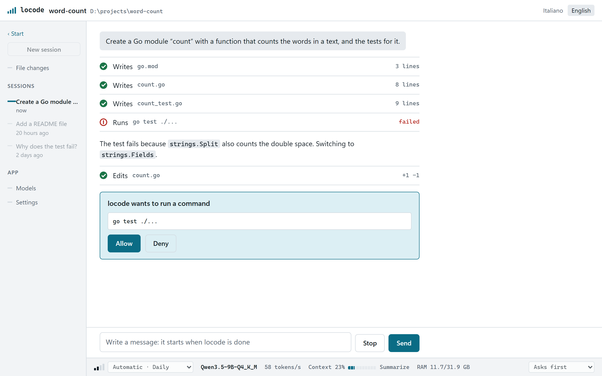
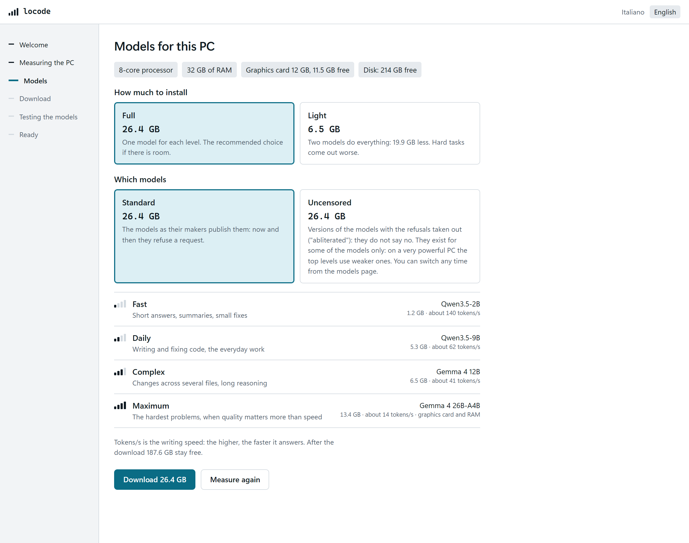

<p align="center"></p>

<h1 align="center">locode</h1>

<p align="center">
  <b>A local coding assistant that configures itself.</b><br>
  One program measures your computer, picks and downloads the open-weight models it can actually run,
  and gives you a coding agent on top of them, in a window of its own or in the terminal.<br>
  Everything runs on your computer: no cloud, no account, no telemetry.
</p>

<p align="center">
  <a href="https://github.com/derob98/locode/releases/latest"></a>
</p>

<p align="center">
  <a href="https://github.com/derob98/locode/releases/latest/download/locode-setup-windows-amd64.exe"><b>Download for Windows</b></a>
  &nbsp;·&nbsp; <a href="#macos-and-linux"><b>macOS and Linux</b></a>
  &nbsp;·&nbsp; <a href="#first-opening">How the setup works</a>
  &nbsp;·&nbsp; <a href="#known-limits">Known limits</a>
</p>

<picture>
  <source media="(prefers-color-scheme: dark)" srcset="assets/readme/chat-dark.png">
  
</picture>

- **It sets itself up.** It measures the processor, memory, graphics card and disk, chooses four models
  that fit (from a small, fast one to the largest the machine can hold), downloads them and tunes each
  one on your computer.
- **It picks the model for the task.** A question goes to the fast model, a refactoring to a large one;
  it moves up by itself when a model gets stuck.
- **It asks before it acts.** Every file it writes, command it runs and page it fetches is confirmed
  first; every change is listed with its diff and can be undone.
- **It stays on your computer.** The models run with [llama.cpp](https://github.com/ggml-org/llama.cpp)
  on your graphics card or processor. Nothing about you, your code or your prompts is sent anywhere.
- **It speaks the open formats.** `AGENTS.md` instructions, MCP servers, `SKILL.md` skills, hooks, and
  an OpenAI-compatible endpoint for your other tools.

## Install

### Windows

1. Download the installer from the [latest release](https://github.com/derob98/locode/releases/latest):
   [`locode-setup-windows-amd64.exe`](https://github.com/derob98/locode/releases/latest/download/locode-setup-windows-amd64.exe)
   for almost every PC, or
   [`locode-setup-windows-arm64.exe`](https://github.com/derob98/locode/releases/latest/download/locode-setup-windows-arm64.exe)
   for ARM ones (Snapdragon).
2. Open it. The program is not signed, so Windows may warn you first:
   - the browser may say the file *isn't commonly downloaded*: choose **Keep** (in Edge: `…` → **Keep**
     → **Keep anyway**);
   - *Windows protected your PC*: click **More info**, then **Run anyway**.
3. Answer **Yes**. locode goes into the Start menu and into **Settings → Apps**, for your user only (no
   administrator rights), and opens.

From a terminal the same install is one line of PowerShell:

```powershell
irm https://github.com/derob98/locode/releases/latest/download/install.ps1 | iex
```

### macOS and Linux

```sh
curl -fsSL https://github.com/derob98/locode/releases/latest/download/install.sh | sh
```

On macOS this makes **locode.app** in `~/Applications` (find it with Spotlight or Launchpad); on Linux,
an entry in the applications menu. Both also put the `locode` command in `~/.local/bin`.

The installers download one program for your platform and check its SHA-256 against the release's
`checksums.txt`. They take a few variables:

| Variable | Effect |
| --- | --- |
| `LOCODE_VERSION` | install a given release, for example `v0.2.0`, instead of the latest |
| `LOCODE_INSTALL_DIR` | put the program somewhere else (default `%LOCALAPPDATA%\Programs\locode`, `~/.local/bin`) |
| `LOCODE_NO_MODIFY_PATH` | Windows: leave the user `PATH` alone |
| `LOCODE_NO_SHORTCUT` | no Start menu entry, applications-menu entry or `locode.app` |

## First opening

Open **locode** from the Start menu, Spotlight or the applications menu (or run `locode app`). The first
time it walks you through the setup, asking once before it downloads anything:

1. **It measures the computer**: processor, memory free right now, graphics card and its memory, disk
   space, plus short speed tests.
2. **It installs the runtime**: a pinned [llama.cpp](https://github.com/ggml-org/llama.cpp) build for
   what it found (CUDA, Vulkan, Metal or CPU), checked against known hashes.
3. **It proposes the models**, one for each of four tiers (`max`, `complex`, `daily`, `fast`): the best of
   its catalog that fit the memory and run fast enough. You choose the full install or a light one, and
   the standard models or their uncensored variants; it shows sizes, licences and the disk needed.
4. **It downloads** them (resumable, SHA-256 verified), **tunes** each one on your machine (GPU layers,
   context size, KV cache, speculative decoding) and shows the tokens per second it measured.

<picture>
  <source media="(prefers-color-scheme: dark)" srcset="assets/readme/setup-dark.png">
  
</picture>

Models take from a few to tens of gigabytes. In a terminal, `locode setup` does the same
(`-yes` to run unattended) and `locode doctor` only measures and tells you what the machine can do.

## Use

In the window: pick a project folder (or none, for a plain chat), then ask. Before the agent writes a
file, runs a command or fetches a page it asks you; every change it makes is listed with its diff and
can be undone. The models page lists what is installed, measures it again and removes what you no
longer use; the settings show the data folder and how to uninstall.

In a terminal:

```sh
cd your-project
locode                                   # the interactive agent
locode "fix the failing test in parser_test.go"
locode -p "list the Go files" -output-format json   # headless: one answer, then exit
```

What the agent does, with local models in mind:

- **Routes each prompt to a tier**: a question goes to `fast`, everyday edits to `daily`, refactoring
  and debugging to `complex` or `max`. It moves down only when the time saved beats the measured
  load time, and moves up by itself when a model gets stuck. `-model` or `/model` pin one.
- **Keeps tool calls working**: malformed calls are repaired and validated against the tool's schema;
  after repeated failures the output is constrained by a grammar.
- **Checks its own edits**: after writing files it runs the project's formatter, linter and tests
  (Go, Node, Python, Rust, or the commands you configure) and feeds the errors back to the model.
- **Spends context carefully**: a map of the repository in the prompt, long files read in chunks,
  a token budget per tool, old tool output pruned first, summaries written by the `fast` model.
- **Shows what is going on**: the active model, tokens per second, context used, VRAM and RAM.

It also has the things you would expect from a coding agent: file, search, shell and web-fetch tools;
permission modes including plan mode; checkpoints and rewind; sessions you can resume and fork; manual
and automatic compaction; `AGENTS.md` and `CLAUDE.md` instructions; MCP servers (stdio, HTTP, SSE);
skills in the `SKILL.md` format; hooks; subagents, also in the background; memory across sessions;
goals and loops; git worktrees; a status line. It speaks English and Italian and follows the system
language (`LOCODE_LANG=en|it` to force one). Type `/help` inside the agent and `locode -h` for its flags.

## Better models over time

New open-weight models come out every month. Each release of locode carries a curated catalog: models
checked for tool calling, with their licence, a published quality score, and every file pinned by
commit and SHA-256. **Look for better models** on the models page (and `locode setup` or
`locode doctor` in a terminal) fetches the catalog of the latest release, makes the choice again for
your machine and tells you, tier by tier, where a model with a higher score now fits, with what it
would download. The app also does it by itself when it opens, at most once a day, and says so on the
start screen. Nothing changes until you say so; the models you have stay on the disk until you
remove them. When the catalog needs a newer locode, it says so.

## Commands

| Command | What it does |
| --- | --- |
| `locode app` | the window (`-no-window` prints its address instead) |
| `locode [flags] [prompt]` | the coding agent in the current folder |
| `locode -p "prompt"` | headless mode (`-output-format text`, `json` or `stream-json`) |
| `locode setup` | measure, runtime, the four model tiers, tuning and the results table |
| `locode doctor` | detect the hardware, run the speed tests, save the profile, look for better models |
| `locode bench` | measure the installed models again |
| `locode models` | list the catalog: sizes, licences, what is installed, tiers and speeds |
| `locode update` | download the current model catalog (SHA-256 checked) |
| `locode serve` | an OpenAI-compatible endpoint on `127.0.0.1` for other tools |
| `locode uninstall` | remove everything locode put on the machine |
| `locode version` | print the version |

## Safety and privacy

- By default the agent asks before it writes a file, runs a command or fetches a URL. Writes are
  limited to the working folder, and destructive commands are always confirmed, in every mode.
  "Always in this session" covers only what the question names: the commands it lists, or one site.
- Settings found inside a project can only restrict what the agent may do until you say you trust
  that folder: a cloned repository cannot approve its own commands.
- The window talks only to a server on `127.0.0.1`, with a new secret for every run. Links in the
  answers open in your own browser.
- The network is used for: the llama.cpp runtime and this project's catalog (GitHub), the models
  (Hugging Face), and whatever you ask the agent to fetch or the MCP servers you configure. Nothing
  about you, your code or your prompts is sent anywhere.

## Update

Download and open the installer again (or run the install command again): your models,
conversations and settings stay. When the new version brings a newer llama.cpp, the first opening
downloads it and measures your models again with it, which takes a few minutes; the old one is
deleted. When the latest catalog has models that only a newer locode can use, the models page says
so. `locode update` refreshes only the model catalog.

## Uninstall

On Windows: **Settings → Apps → locode → Uninstall**. It asks whether to remove the models and data
too, or to keep them for a later install. Everywhere, from a terminal:

```sh
locode uninstall
```

It lists what it is about to delete and asks (`-yes` to skip the question):

- the data folder with the runtime, models, profile, sessions and settings. If you moved it to
  another disk behind a symlink or a junction, the real folder is deleted too, not just the link;
- the programs, the Start menu entry and the entry in Windows' installed apps, `locode.app` on macOS,
  the applications-menu entry and its icon on Linux;
- on Windows, the entry the installer added to your user `PATH`.

The data folder is `%LOCALAPPDATA%\locode` on Windows, `~/Library/Application Support/locode` on
macOS and `~/.local/share/locode` (or `$XDG_DATA_HOME/locode`) on Linux.

What stays, because it lives in your projects: `.locode/` folders (project settings, worktrees) and
`worktree-*` git branches created with `-worktree`. On macOS and Linux, also a `PATH` line you may
have added to your shell profile by hand.

## Platforms

| System | Processors | GPU backends | Window |
| --- | --- | --- | --- |
| Windows 10 and 11 | x64, ARM64 | CUDA (x64), Vulkan, CPU | its own (WebView2); without WebView2, an Edge or Chrome app window |
| macOS 13 or later | Apple Silicon, Intel | Metal (Apple Silicon), CPU | its own (WebKit) |
| Linux (glibc) | x64, ARM64 | CUDA (x64), Vulkan, CPU | a Chrome, Chromium or Edge app window, or the default browser |

Windows 11 has WebView2 built in; most Windows 10 PCs have it too. On Linux the program stays a
static binary that also runs on servers without a desktop. The llama.cpp runtime it downloads is the
upstream prebuilt one.

## Known limits

- **Local models are weaker than the large hosted ones.** Routing, repair and verification narrow
  the gap on everyday work; they do not close it on hard problems. There are no public benchmark
  numbers for locode.
- **Windows is where it is developed and tested with real models.** The Linux and macOS builds are
  covered by automated tests and by an automated run of the installer, `doctor`, the window (macOS)
  and uninstall, not by daily use.
- **The programs are not code-signed.** See the warnings under *Install*. Antivirus software or
  company policy may still object, and Windows 11 Smart App Control, where it is turned on, blocks
  unsigned programs with no per-app exception. If you download a macOS binary with a browser instead
  of the install command, remove the quarantine flag: `xattr -d com.apple.quarantine locode-darwin-arm64`.
- **One large model in memory at a time.** Changing tier means loading another model, which takes
  from seconds to minutes depending on the disk.
- **Models are chosen by memory fit and measured speed**, with quality scores from the catalog; how
  well each one handles tools is checked when the catalog is made, not on your machine.
- Model files you already have elsewhere are not reused. There is no self-update: run the installer
  again. No plugins, themes, vim mode or editor integration.

## Feedback

Bug reports and ideas are welcome in the [issues](https://github.com/derob98/locode/issues). For a
bug, say which system and version you have (`locode version`); if the window misbehaved on Windows,
`logs\app.log` in the data folder (see *Uninstall* for where it is) says what happened.

## Licence

The programs are free to use, for personal and commercial work. Copyright © 2026 Gianluca De
Robertis, all rights reserved; the source code is not published. See [LICENSE](LICENSE).
The open-source components inside the program are listed with their licences in
`THIRD_PARTY_LICENSES.txt`, attached to every release. llama.cpp and the models are separate works,
downloaded under their own licences, which the setup shows before each download.
